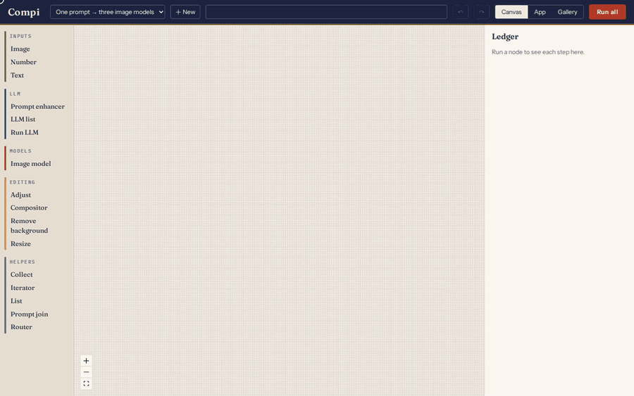

# Compi

[](https://github.com/rajandevkota98/compi/actions/workflows/ci.yml)

A node-based AI image workflow studio, in the spirit of Figma Weave and ComfyUI.
Each node has inputs, settings (prompt, model…) and outputs; wire them on a canvas, run one node
or all, attach a **checker agent** to any node, and watch every step live.



<sub>Full-quality video: [docs/demo.mp4](docs/demo.mp4)</sub>

- **Engine:** Python + LangGraph. A workflow is JSON; only nodes whose inputs or settings changed run
  again (Merkle-keyed cache). Lists run downstream nodes once per item, in parallel.
- **Checker agents:** retry the node with the checker's fix hint, then flag it for a person.
  A flagged node holds only its own branch; accept or fix it and the next run continues.
- **Models:** image models through OpenRouter; LLM and vision checks through Claude.
  Editing nodes (resize, adjust, remove background, compositor) are local and free.
- **Canvas:** React + React Flow. Canvas mode (the graph) and App mode (inputs as a form).

## Nodes

| Group | Node types |
|---|---|
| Inputs | `text.input`, `number.input`, `image.input` |
| LLM (Claude) | `llm.run`, `llm.enhance` (prompt enhancer), `llm.list` (text → list) |
| Models (OpenRouter) | `image.generate` |
| Editing (local, free) | `image.resize`, `image.adjust`, `image.remove_bg`, `image.composite` |
| Helpers | `prompt.concat`, `router`, `list.text`, `list.iterate`, `list.collect` |
| Checkers | `check.text`, `check.vision` — attach to any node to verify its output |

## Run

```bash
git clone https://github.com/rajandevkota98/compi && cd compi
cp .env.example .env     # add ANTHROPIC_API_KEY and OPENROUTER_API_KEY
./setup.sh               # installs if needed, builds the canvas, starts in the background
```

Needs Python 3.12+ with [uv](https://docs.astral.sh/uv/) and Node 22+ (`setup.sh` picks Node 22 from nvm if it is installed).
Open http://localhost:8000. Three ready-made workflows are included (`workflows/`).

| Command | Does |
|---|---|
| `./setup.sh restart` | rebuild the canvas and restart (after code changes) |
| `./setup.sh stop` / `start` | stop / start the server |
| `./setup.sh logs` | follow the server log |
| `./setup.sh dev` | run in the foreground (Ctrl+C to stop) |
| `./setup.sh install` | reinstall dependencies |

For live frontend work run `npm run dev` in `frontend/` (proxies `/api` to port 8000).

## Check

```bash
cd backend && uv run ruff check . && uv run ruff format --check . && uv run pyright && uv run pytest
cd frontend && npm run check
```

## Layout

```
backend/src/compi/
  domain/    spec, sockets, verdict           pure types
  engine/    validate, keys, plan, compile, step, run, review, cache
  nodes/     inputs, helpers, llm, models, edit, checks   one function per node type
  services/  llm (Claude), images (OpenRouter), media, costs, settings   all I/O
  api/       app (FastAPI), runs (background runs + SSE)
frontend/src/  App, NodeCard, Inspector, Ledger, Palette, AppMode, ParamField, Preview
workflows/     ready-made workflow JSON
```

Adding a node type = one decorated async function in `backend/src/compi/nodes/`; the canvas draws
its sockets and settings form from the schema, with no frontend change.

## License

MIT — see [LICENSE](LICENSE).
